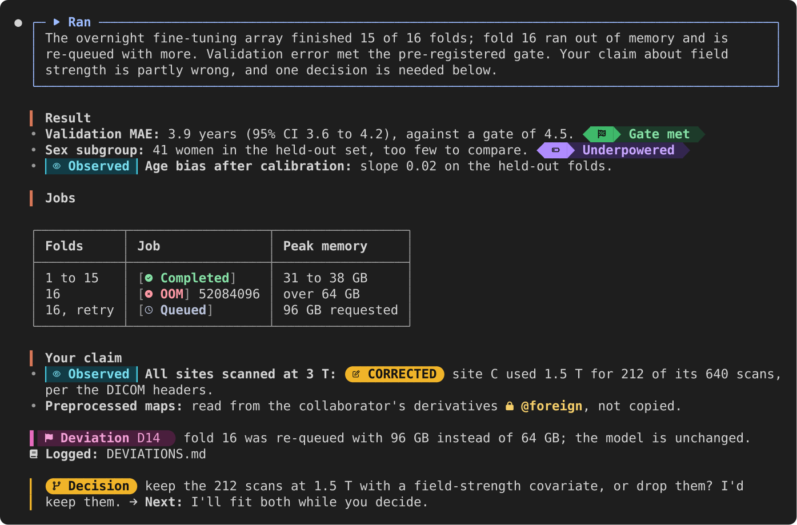

# emphasis for Claude Code

A Claude Code plugin that makes replies about research work easy to scan. Claude writes short markers such as `[[Confirmed]]`, `[[Gate missed]]` or `[[OOM 4410273]]`, and the plugin draws each one in a shape and color that says what kind of marker it is. Replies that report work open with a brief card.



The screenshot uses `icons: nerd-font`. The default, which needs no special font, looks like [this](docs/screenshot-unicode.png); on a light theme, like [this](docs/screenshot-light.png).

The plugin changes only what the terminal draws. The stored conversation, copied text and exports keep plain Markdown. It calls no model and costs nothing to run.

## Install

```sh
git clone https://github.com/lix229/claude-research-emphasis.git
cd claude-research-emphasis
./install.sh
```

Then start a new Claude Code session. To bring a running session over, `/exit`, then `claude --continue`.

`install.sh` does two things, and you can run it again safely:

1. It registers this folder as a plugin marketplace and installs the `emphasis` plugin at user scope (`claude plugin marketplace add <folder>`, then `claude plugin install emphasis@claude-research-emphasis`).
2. It adds an import of `reply-style.md` to `~/.claude/CLAUDE.md`, so Claude knows which words to write and when to open with a brief card. A plugin cannot add these rules itself: Claude Code does not let plugins change the system prompt.

The plugin also attaches a one-line reminder of the rules (about 60 words) to each message you type, so Claude keeps using the markers in long sessions. Turn it off with the `reminder` option.

To install by hand instead, run the two `claude plugin` commands from step 1, then add this to `~/.claude/CLAUDE.md`, with the path to your clone:

```markdown
## Reply style (emphasis)
Replies are drawn by the emphasis plugin. Follow its rules:
@/path/to/claude-research-emphasis/reply-style.md
```

Because the marketplace is a local folder, Claude Code reads the plugin from your clone. After a `git pull`, run `/reload-plugins` in a session.

**Requirements.** Claude Code with function-hook plugins (checked on 2.1.330, Linux) and a terminal with 24-bit color. Inside tmux, Claude Code drops to 256 colors and the soft chip colors look grayer.

**Rounded pills and icons** need a [Nerd Font](https://www.nerdfonts.com/) in your terminal and `icons` set to `nerd-font` (see Options). To check whether your terminal already draws the glyphs, run `printf '  \n'`: you should see a half circle, a check mark, a question mark, a person and another half circle. Use a "Mono" variant of the font so icons stay one cell wide.

## What it draws

Each family of markers has its own shape, so you can tell what kind of marker it is before reading it:

| Family | Words | Shape |
|---|---|---|
| Evidence | Observed, Inferred, Unverified, Cited | filled chip with thin colored edges, at the start of the bullet or paragraph it qualifies (a single tag written at the end is moved there); the mark shows the grade (● observed, ◐ inferred, ○ unverified, § cited) |
| Verdict on a claim you made | Confirmed, Corrected, Contradicted | solid stamp in capitals |
| Gates (pre-registered pass/stop thresholds) | Gate met, Gate missed, Fold, Shelve, Exploratory, Underpowered | two-tone badge: a solid icon cell, then a soft label |
| Work status | Done, Passed, Fixed, Recommended, Failed, Blocked, Partial, Skipped, At risk, Handed over | soft chip |
| Asks | Needs you, Decision | the one filled amber pill; a paragraph that opens with an ask gets an amber bar beside every line |
| Disclosure | Deviation | magenta flag |
| Jobs (Slurm or any scheduler) | Submitted, Queued, Running, Completed, Cancelled, OOM, Killed 143 | `[● Running]`, like a log line |
| Ownership | Owned, Shared, Foreign | `@foreign` handle |
| Hazards | Destructive, Irreversible, GPU quota | solid, with hazard stripes |
| Kind of work | Investigate, Propose, Changed, Ran | opens the brief card |

A word may carry detail, drawn in regular weight after the bold word: `[[Completed 16/16]]`, `[[Deviation D12]]`, `[[OOM 4410273]]`. Any other word in `[[ ]]` is drawn as a dim `‹ tag ›`.

Also:

- **Brief card.** A reply that opens with a kind-of-work marker has its first paragraph drawn inside a bordered card, with the kind of work in the card's top border. The details follow below it.
- **Tables.** A table that contains markers is drawn by the plugin, so the markers inside it are colored. A table wider than the window is left to Claude Code's own renderer.
- **Messages from other agents.** Messages from teammates, subagents and other sessions, and background-task notifications, get a colored sender line. Status words in the message (HANDED OVER, PASSED, FAILED, COMPLETED, RUNNING, OOM) become markers, job ids are bold, and only the first three lines are shown (ctrl+o shows the full message).
- **Links stay links.** `[label](https://…)`, `<https://…>` and bare `https://` addresses are drawn as clickable hyperlinks, as Claude Code draws them. On a terminal without hyperlink support, the address is printed after the label.
- **Text.** Color is kept for meaning: bold is plain bold (set `boldColor` to color lead labels such as **Cause:**), inline code is set apart by a tinted background, and links are blue. `##` headings get an accent bar; blockquotes get a dim bar on every line and stay at full brightness (for manuscript text you will copy); `✓` / `✗` / `→` are colored, and `├──` / `└──` tree lines are dimmed.
- **Colors follow your theme.** On a light Claude Code theme the plugin switches to light colors. On the colorblind (daltonized) and ANSI themes it uses the theme's own colors, so markers stay distinguishable in the palette you chose.

## Options

Set these in Claude Code's config menu (`/config`, under the plugin's name), or with `claude plugin configure emphasis@claude-research-emphasis`:

| Option | Values | Default |
|---|---|---|
| `icons` | `unicode` (marks any font draws), `nerd-font` (Nerd Font icons; rounded, arrow and slanted chip ends), `none` | `unicode` |
| `palette` | `auto` (follow the Claude Code theme), `dark`, `light`, `theme` (Claude Code's theme colors, solid chips) | `auto` |
| `reminder` | attach the one-line rules reminder to each message you type | on |
| `boldColor` | color of bold lead labels: a theme key such as `suggestion`, a color name or hex; empty keeps the text color | empty |

## Changing the words

The words, their families, colors, marks and one-line meanings are the `WORDS` table in `hooks/emphasis.ts`. Other spellings that map to a word are in `SYNONYMS`. The rules Claude reads are generated from the same table, so after editing it, rebuild them:

```sh
node --experimental-strip-types scripts/build-rules.ts > reply-style.md   # Node 22.6 or newer
# or: bun scripts/build-rules.ts > reply-style.md
```

Then `/reload-plugins` in a running session, or start a new one.

## Uninstall

```sh
claude plugin uninstall emphasis@claude-research-emphasis
claude plugin marketplace remove claude-research-emphasis
```

Then delete the "Reply style (emphasis)" section from `~/.claude/CLAUDE.md`.

## Limits

- Claude follows the rules in `reply-style.md`; the plugin only draws what Claude writes. Smaller models (Haiku) sometimes skip the markers. A session keeps the rules it started with: after updating, start a new session (or `/exit`, then `claude --continue`).
- Claude Code only. Codex CLI plugins can add skills, MCP servers and hooks, but cannot change how a reply is drawn, so the markers would show as plain `[[Done]]` text there.

## Credits

The idea of `[[Word]]` markers, and the Nerd Font icon tables, come from [pi-emphasis](https://github.com/johnlindquist/pi-emphasis) by John Lindquist, an extension for the Pi coding agent (MIT). See `LICENSE`.
